<p align="center">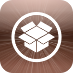</p>

<h1 align="center">iFizBox</h1>

<p align="center"><b>A package manager with the iOS 6 look, for modern iPhones.</b><br>
Browse APT repos and AltStore sources, install tweaks on a jailbroken iPhone, and install apps signed with your own
certificate, on the website or in the sideloaded app.</p>

<div align="center"><a href="https://ifizbox.com"></a>
<a href="https://github.com/RyanAHayden/iFizBox/releases/latest"></a>
<a href="LICENSE"></a>

<a href="https://discord.gg/3XASvpjbgp"></a></div>

<p align="center">
  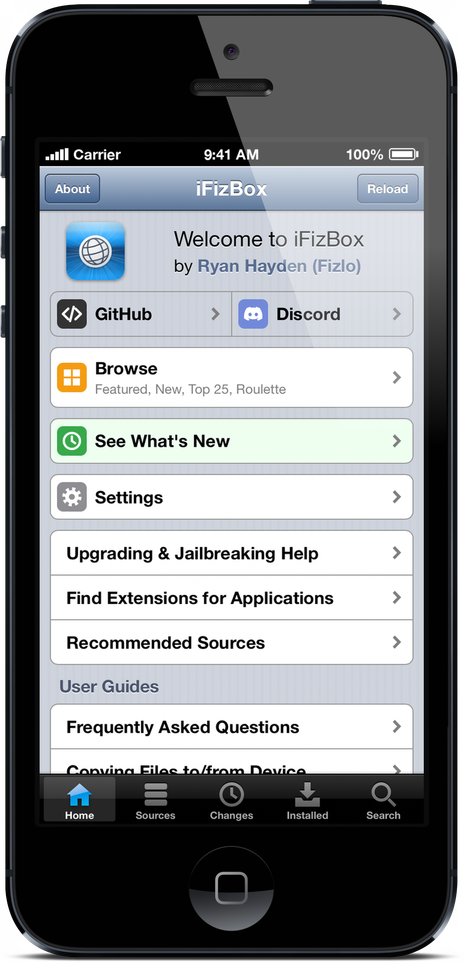
  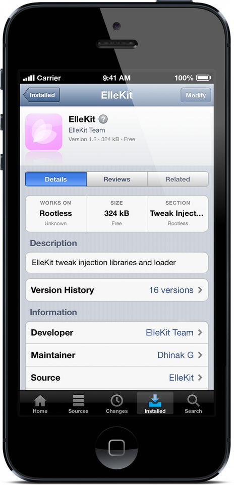
  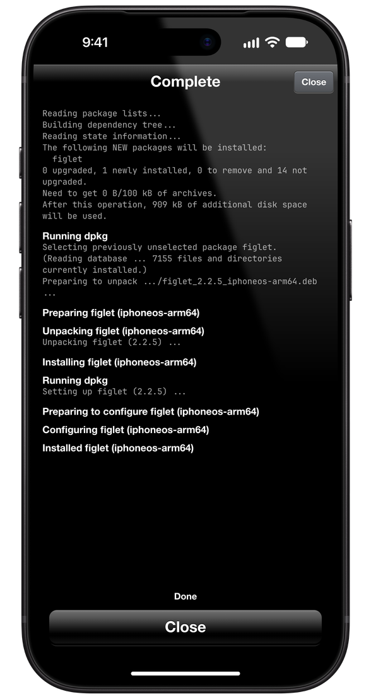
</p>

> [!NOTE]
> iFizBox is inspired by Cydia by Jay Freeman (saurik). It is **not affiliated with Cydia or SaurikIT**, and Cydia
> is SaurikIT's trademark. It uses Cydia's section icons and purpose badges and some of its interface wording, under
> GPLv3: see [Credits](#credits).

## Contents

- [The three builds](#the-three-builds)
- [Screenshots](#screenshots)
- [Install](#install)
- [How it works](#how-it-works)
- [Build and test](#build-and-test)
- [Host your own server](#host-your-own-server)
- [Project layout](#project-layout)
- [Contributing](#contributing)
- [Credits](#credits)
- [License](#license)

## The three builds

One frontend (`web/app/`, plain HTML, CSS and JavaScript modules with no build step) runs in all three.

| | Build | What it does | Needs |
|:-:|---|---|---|
|  | **Website**, [ifizbox.com](https://ifizbox.com) | Browse APT repos and AltStore sources, add your own, see what changed, search. Signs and installs apps **in your browser** with your certificate. No login. | Any iPhone with Safari |
|  | **Jailbreak app** (`iFizBox.deb`) | Everything the website does, plus installing `.deb`s through apt with a root helper (a queue that downloads 3 at a time, where one failed package skips only what needs it), a background upgrade check, and Shortcuts actions. The helper installs IPAs directly, with no signing (with AppSync Unified). | A rootless jailbreak (iOS 15 and later, `iphoneos-arm64`) |
|  | **Sideload app** (`iFizBox.ipa`, the LITE icon) | The same app without the root helper: AltStore-style sources, apps signed and installed on the phone with your certificate, re-signing, and updates to the apps you installed, checked in the background too. | Your own signing certificate (`.p12` and `.mobileprovision`) |

The jailbreak app and the sideload app are one app, two builds: the same `native/` shell, with or without the root
helper.

## Screenshots

Real pages with live sources at the iPhone 18 Pro's screen size (402×874 points at 3x), in Apple's iPhone 18 Pro
bezel: silver for the website, black for the jailbreak app. Framed by [`tools/readme_shots.py`](tools/readme_shots.py).

**Website**

<p align="center">
  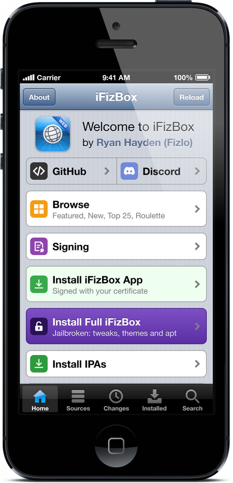
  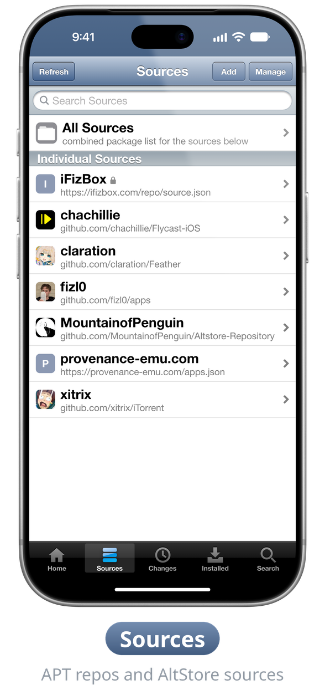
  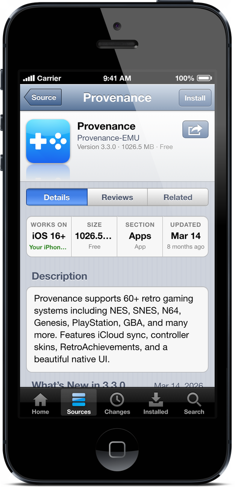
  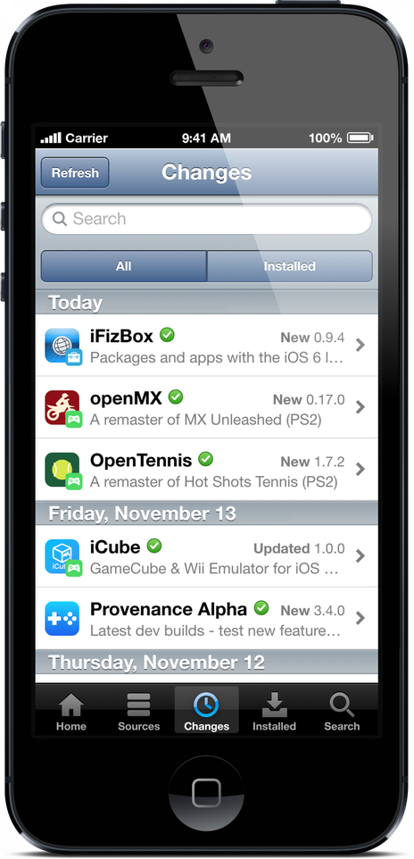
</p>

**Jailbreak app** (the sources, packages and install of a rootless iPhone)

<p align="center">
  
  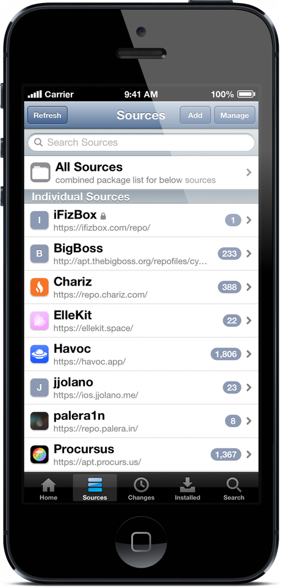
  
  
</p>

<details>
<summary><b>More screenshots</b></summary>

| | | | |
|:-:|:-:|:-:|:-:|
| 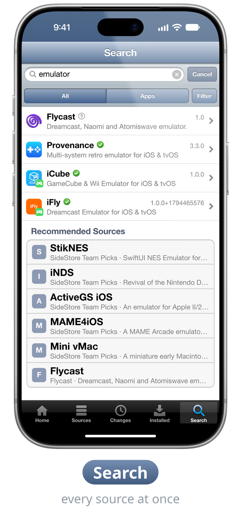 | 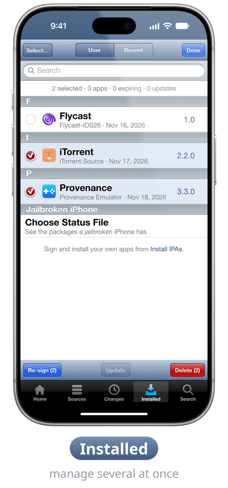 | 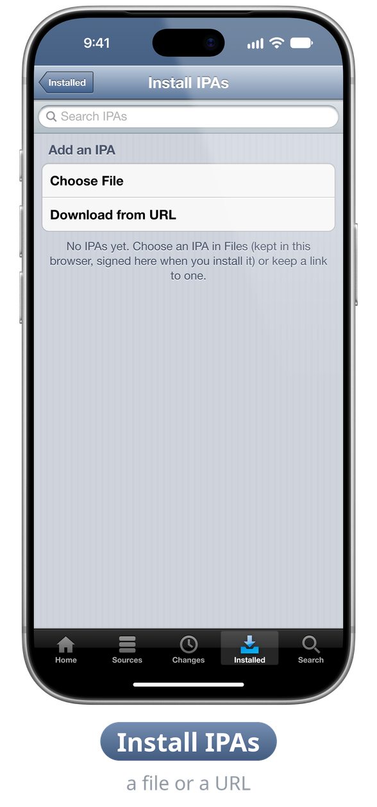 | 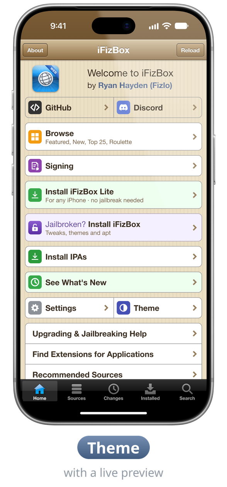 |
| Search | Installed, Manage mode | Install IPAs | Theme > Light, with the preview |
| 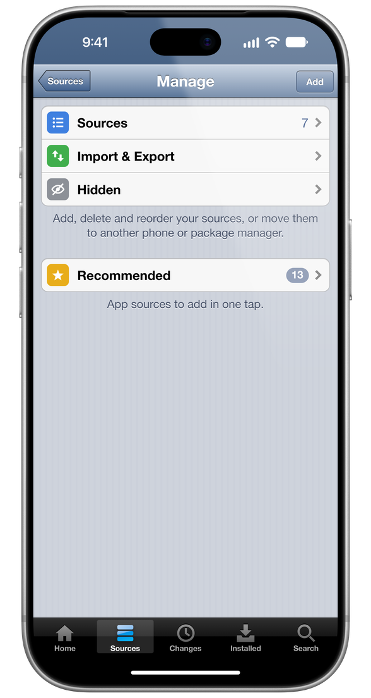 | 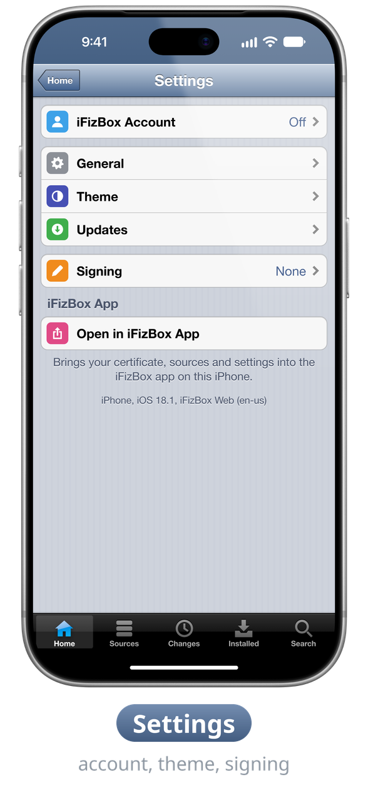 | 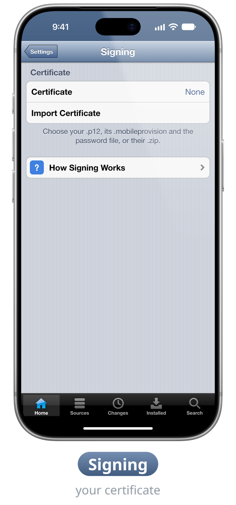 | 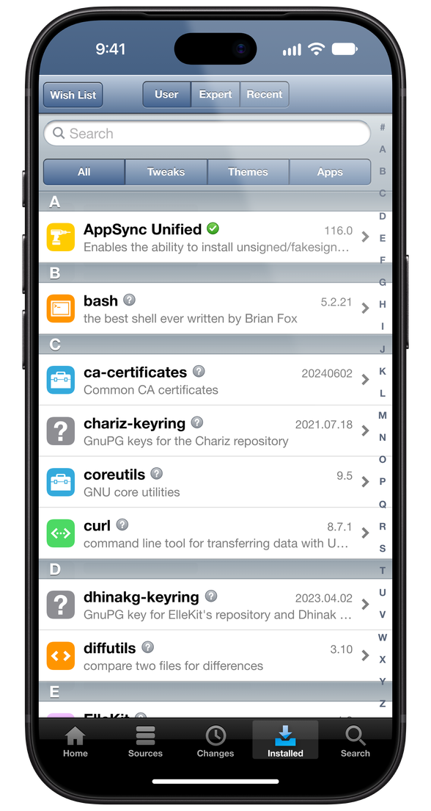 |
| Sources > Manage | Settings | Settings > Signing | Installed (jailbreak app) |

</details>

## Install

### Website

Open **<https://ifizbox.com>** in Safari. Nothing to install and no account. To install apps from the website, add
your certificate under **Settings > Signing**: the `.p12`, its password and the `.mobileprovision` stay in your
browser, and apps are signed there.

### Jailbreak app (rootless, iOS 15+)

Add iFizBox's own APT repo to Sileo or Zebra, then install **iFizBox** (`com.ryha.ifizbox`):

```text
https://ifizbox.com/repo/
```

On the website, **Home > Jailbroken? Install iFizBox** does this for you (Add to Sileo, Add to Zebra, Copy Repo URL, or
Download .deb). You can also get `iFizBox.deb` from the
[latest release](https://github.com/RyanAHayden/iFizBox/releases/latest) and install it with
`apt-get install ./iFizBox.deb`, which pulls in its dependencies (plain `dpkg -i` doesn't). Once installed, the
repo stays in iFizBox as a built-in source, so iFizBox updates itself like any other package.

### Sideload app (LITE)

No certificate yet? [docs/developer-account.md](docs/developer-account.md) sets one up from your own Apple Developer
account, with apps keeping their bundle IDs and notifications.

**Have a developer account? Help your friends by sharing your certificate.** [SideDrop](https://github.com/RyanAHayden/sidedrop)
is a site you run yourself: friends register their iPhone once, and every app is signed for them with your
certificate, ready to install from Safari. Anyone who installs from it can pull the certificate out, so share it with
people you trust.

With your certificate added on the website (**Settings > Signing**), tap **Home > Install iFizBox Lite**: the website
signs the IPA in your browser and iOS asks to install it. The installed app comes with that certificate (and your
sources and settings), so it signs and installs apps on the phone straight away. That's all it takes.

You don't need another sideloading tool, but iFizBox's AltStore source works in Feather, AltStore or SideStore too:

```text
https://ifizbox.com/repo/source.json
```

`iFizBox.ipa` is also on every [release](https://github.com/RyanAHayden/iFizBox/releases/latest). The app looks for
a new release every time it opens: a newer iFizBox shows as an upgrade in Changes, and installing it signs it on the
phone and installs it over itself.

## How it works

<!-- Experimental: if rendering fails, preview on GitHub -->
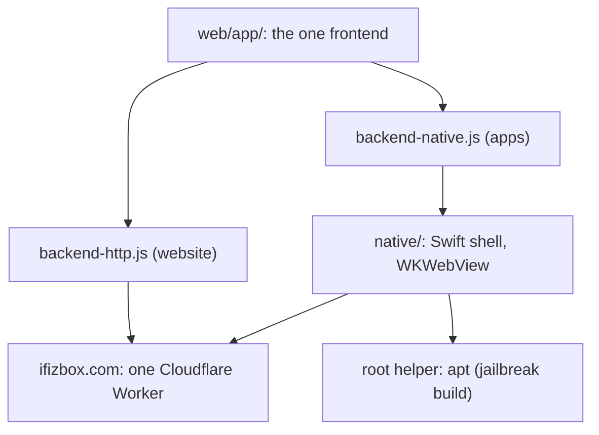

- **One frontend.** The UI only talks to a backend interface: `backend-http.js` on the website and
  `backend-native.js` in the apps. The parsing, version comparison, Changes and upgrade logic in `web/app/core/` is
  plain JavaScript tested with `node --test`.
- **The apps** are a Swift shell around a WKWebView that runs `web/app/`, built on Linux into both the rootless
  `.deb` (with a root helper for apt) and the sideload IPA (without it). They're designed to hold 120 Hz: animations
  use only transform and opacity, long lists are virtualised, and parsing runs in a Web Worker.
- **ifizbox.com is a single Cloudflare Worker** (`worker/`), with no server of our own:

  | Path | What it does |
  |---|---|
  | `/` | the website: `web/app/` as static assets, revalidated on every load |
  | `/api/fetch` | the website's fetch proxy (APT repos and AltStore sources don't let a page read them), behind an SSRF guard: no private, loopback or link-local addresses, with size and time limits |
  | `/api/applookup`, `/api/appreviews`, `/api/ipainfo` | App Store details and reviews for an app, and an IPA's `Info.plist` (supported iOS versions) |
  | `/sign/status` | tells Settings > Signing the server answers |
  | `/sign/manifest`, `/sign/host/*` | the install manifest iOS needs when the app signs on the phone, and iFizBox's own update held for 10 minutes while iOS replaces the app |
  | `/sign/upload`, `/sign/up/*` | an app the website signed in the browser, held for 10 minutes for iOS's install prompt |
  | `/repo/` | iFizBox's flat APT repo, served from the latest GitHub release's assets |
  | `/repo/source.json` | iFizBox's AltStore source |
  | `/api/account/*` | iFizBox Account (below) |
  | `/reviews/*` | package reviews (Cloudflare D1) |

- **Signing happens on your own device.** The sideload app signs on the iPhone (the jailbreak app needs no
  signing: its helper installs IPAs directly). The website signs in the browser with
  [zsign](https://github.com/zhlynn/zsign) compiled to WebAssembly (`web/app/vendor/zsign`, built reproducibly by
  `tools/build-zsign-wasm.sh`). No server ever signs anything or sees your key. Details:
  [docs/signing.md](docs/signing.md).
- **iFizBox Account** ([docs/account.md](docs/account.md)) is optional. It keeps your sources, the settings that
  travel between devices, ignored upgrades, installed-app records and your certificate, all **end-to-end encrypted**
  (AES-GCM, with a 128-bit key made on your device), so a new phone or the website can get them back. The server
  stores only ciphertext under a hash of the id. If you lose the key, nobody can recover the data.
- **Shortcuts, Siri and Spotlight:** Check for Updates, Add Source, Install All Updates, Respring and more
  ([docs/shortcuts.md](docs/shortcuts.md)).

## Build and test

Requirements: Python 3 (standard library only) and Node.js 22 or later.

```bash
tools/check.sh                 # the test gate: every test_*.py, node --test web/app, node worker/test.mjs
node worker/node.mjs           # the website, /api/fetch and /sign/* on http://localhost:8787
cd worker && npx wrangler dev  # or the same Worker under Wrangler, as on ifizbox.com
```

`tools/check.sh` also rebuilds the zsign WebAssembly where Emscripten (`emcc`) is installed and fails if the
committed copy doesn't match its source. It also builds the native apps when their toolchain is set up, and says
what it skipped when it isn't.

<details>
<summary><b>Building the apps on Linux</b> (no Mac, no Theos)</summary>

`native/build.sh` builds both apps from one executable and checks them:

```bash
export SWIFT_TOOLCHAIN=<path/to/swift-6.4-toolchain>   # the dir holding usr/bin/swiftc
export IOS_SDK=<path/to/iPhoneOS.sdk>                  # extracted from an Xcode .xip
native/build.sh --probe     # says what is missing
native/build.sh             # native/build/iFizBox.deb and native/build/iFizBox.ipa (or: deb | ipa)
```

It also needs `ld64.lld` (rustup's, or one on `PATH`) and `ldid` or `rcodesign` to sign the entitlements. Full
notes: [docs/native.md](docs/native.md). Releases: [docs/release.md](docs/release.md).

</details>

## Host your own server

Anyone can run their own copy of the Worker for free and point iFizBox at it. Full guide:
[worker/README.md](worker/README.md).

[](https://deploy.workers.cloudflare.com/?url=https://github.com/RyanAHayden/iFizBox/tree/main/worker)

```bash
git clone https://github.com/RyanAHayden/iFizBox && cd iFizBox/worker
npx wrangler login
npx wrangler deploy     # creates the KV storage on the first deploy and prints your https://….workers.dev address
```

Or on your own machine or in Docker:

```bash
node worker/node.mjs    # PORT, HOST, HOST_IDS, TTL as in worker/wrangler.toml
docker build -f worker/Dockerfile -t ifizbox . && docker run -d -p 8787:8787 -v ifizbox-data:/data ifizbox
```

Then in the sideload app: **Settings > Signing > Signing Server**, paste your address and tap **Check Server**. iOS accepts
install manifests only over HTTPS with a trusted certificate, so a self-hosted Node server has to sit behind
Tailscale, a Cloudflare Tunnel or a reverse proxy with a real domain.

ifizbox.com itself is deployed by Cloudflare Workers Builds on every push to `main`
(`tools/buildinfo.sh && cd worker && npx wrangler deploy -c wrangler.ifizbox.toml`).

## Project layout

| Path | What's there |
|---|---|
| `web/app/` | the one frontend: screens, iOS 6 CSS, `core/` (pure JS, `node --test`), `brand.js` (name, domain, IDs) |
| `worker/` | the ifizbox.com Cloudflare Worker, and `node.mjs` to run it on Node |
| `native/` | the Swift shell, the root helper, `build.sh` for the `.deb` and the IPA |
| `tools/` | the test gate, release and icon scripts, the zsign WebAssembly build |
| `docs/` | design notes: [Cydia's behaviour](docs/cydia.md), [Sileo and Zebra](docs/sileo-zebra.md), [native](docs/native.md), [signing](docs/signing.md), [sideload](docs/sideload.md), [settings](docs/settings.md), [account](docs/account.md), [Shortcuts](docs/shortcuts.md), [releases](docs/release.md) |
| `testrepo/` | sample APT and AltStore sources for the tests |

## Contributing

Work is planned in `plan/TODO.md` and run by [agent-runner](https://github.com/FIZL0/agent-runner)
(`tmux new -s ifizbox agent-runner run 3`). The rules every change follows are in [AGENTS.md](AGENTS.md). The
short version: iOS 6 is the base style, the gate (`tools/check.sh`) must pass, the Python stays standard-library
only, and no Apple artwork or Cydia logo goes into the repository.

Bugs and ideas: [GitHub issues](https://github.com/RyanAHayden/iFizBox/issues) or the
[Discord](https://discord.gg/3XASvpjbgp).

## Credits

- Inspired by **Cydia** by Jay Freeman (saurik). iFizBox is not affiliated with Cydia or SaurikIT, and Cydia is
  SaurikIT's trademark. The interface is redrawn in CSS and SVG, and no Apple artwork is included. From Cydia's
  GPLv3 source iFizBox uses:
  - its section icons and purpose badges (`web/app/icons/sections/`), copied unchanged; credit and details are in
    [that folder's README](web/app/icons/sections/README.md);
  - some of its interface wording (titles, buttons and alert sentences, listed in
    [docs/cydia.md](docs/cydia.md#ui-strings)), with typos fixed.
- The phone in the screenshots is the iPhone 5 from Teehan+Lax's iOS 6 GUI PSD. Only the rendered screenshots are
  in the repository, not the kit.
- [zsign](https://github.com/zhlynn/zsign) (MIT) and OpenSSL (Apache-2.0) in the website's signer, with their licences
  in `web/app/vendor/zsign/`.

## License

[GPL-3.0-or-later](LICENSE). Anyone who distributes iFizBox or a modified version must release the source under the
same license.
