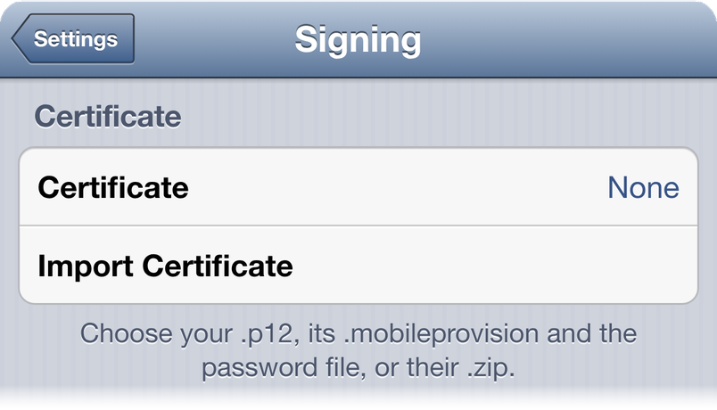

# Setting up your Apple Developer account

How to get a certificate and profile of your own that sign apps the way paid signing services do: each app keeps its
own bundle ID (so it replaces the original, not a copy beside it) and gets its own notifications. Checked on a stock
iPhone 15 Pro (journal/2026-11-19-f237-keep-bundle-id). Why it works is in [signing.md](signing.md#keep-bundle-ids):
iOS checks the entitlements' `application-identifier` against the profile, but never the app's Info.plist bundle ID,
and registers the app for push under the Info.plist one.

You end up with three things: a `.p12` (certificate and private key), its password and a `.mobileprovision`.

## 1. Join the Apple Developer Program

[developer.apple.com/programs/enroll](https://developer.apple.com/programs/enroll), $99 a year. A free Apple ID
can't do this: it has no Ad Hoc profiles and no Push.

## 2. Make an Apple Distribution certificate

First a certificate signing request (CSR), which makes the private key on your computer.

**On a Mac:** Keychain Access > Keychain Access menu > Certificate Assistant > Request a Certificate From a Certificate
Authority. Your email and name, **Saved to disk**, Continue.

**Anywhere else (Linux, Windows with OpenSSL):**

```sh
openssl genrsa -out key.pem 2048
openssl req -new -key key.pem -out request.csr -subj "/emailAddress=you@example.com/CN=Your Name/C=US"
```

Then on [developer.apple.com/account/resources/certificates](https://developer.apple.com/account/resources/certificates/list):
**+** > **Apple Distribution** > upload the CSR > Download (`distribution.cer`).

Turn it into a `.p12`:

- **Mac:** double-click `distribution.cer`, then in Keychain Access > My Certificates, right-click
  "Apple Distribution: Your Name" > Export > `.p12`, with a password.
- **OpenSSL:**

  ```sh
  openssl x509 -inform der -in distribution.cer -out cert.pem
  openssl pkcs12 -export -legacy -inkey key.pem -in cert.pem -out cert.p12
  ```

  `-legacy` uses the older encryption that every iOS version and zsign open (OpenSSL 1.1 has no `-legacy`
  flag and needs none).

Keep the `.p12` and its password safe: anyone with both can sign as you. The certificate lasts a year.

## 3. Make an App ID with Push

[Identifiers](https://developer.apple.com/account/resources/identifiers/list) > **+** > App IDs > App:

- **Explicit**, an ID of your own such as `com.yourname.youtube`. Not a wildcard (`com.yourname.*`): Apple gives
  wildcards no Push.
- Tick **Push Notifications**. App Groups and Associated Domains are worth ticking too, since many apps ask for them.
- Continue, Register.

One App ID with Push covers every app's notifications: iOS registers each app for push under its own Info.plist ID,
not the App ID. Apps signed with the same App ID do share a keychain and App Groups, so they can see each other's
sign-ins; make an App ID (and a profile) per app only if you want those kept apart.

If you add a capability to an App ID later, make its profile again (step 5): a profile holds the capabilities the
App ID had when it was made.

## 4. Register your iPhones

[Devices](https://developer.apple.com/account/resources/devices/list) > **+**: a name and the iPhone's UDID. A Mac's
Finder shows it (click the line under the iPhone's name until it says UDID), and so does `idevice_id -l`. Settings >
Signing in iFizBox says whether this iPhone is in the profile and has Copy UDID.

Apple allows 100 iPhones per account per membership year; removing one frees its slot only at renewal.

## 5. Make an Ad Hoc profile

[Profiles](https://developer.apple.com/account/resources/profiles/list) > **+** > **Ad Hoc** (under Distribution).
Pick the App ID, your Apple Distribution certificate and your iPhones, name it, Download the `.mobileprovision`.

Ad Hoc, not Development: a development profile gets only Apple's sandbox push, which apps' own servers don't send to.
Make the profile again whenever you add an iPhone.

Check it has Push:

```sh
security cms -D -i profile.mobileprovision | grep -A1 aps-environment                          # Mac
openssl smime -inform der -verify -noverify -in profile.mobileprovision | grep -A1 aps-environment   # elsewhere
```

It should say `production`.

## 6. Use it in iFizBox

Import the `.p12`, the `.mobileprovision` and the password in **Settings > Signing**, and leave **Keep Bundle IDs** on.
Delete the App Store copy of the app first (iOS won't sign over it), install, and allow notifications.

<p align="center"> Signing: Import Certificate" width="320"></p>

## When it doesn't work

- **"Unable to install … integrity could not be verified"**: this iPhone isn't in the profile. Add its UDID (step 4),
  make the profile again (step 5) and import the new one.
- **The app installs but won't open**: Developer Mode is off (Settings > Privacy & Security > Developer Mode, iOS 16
  and later), or the certificate or profile expired.
- **No notifications**: the profile has no `aps-environment` (Push wasn't on when it was made, or it's a development
  profile), Keep Bundle IDs was off when the app was signed, or the app was never allowed to send notifications.
- **Every app stops opening at once**: the certificate expired or was revoked. Make a new one (step 2) and a new
  profile (step 5), then re-sign. In the sideload app, Home shows a tile when the certificate or profile is about to
  expire (Settings > Signing > Show Expiry Warning sets how early).
